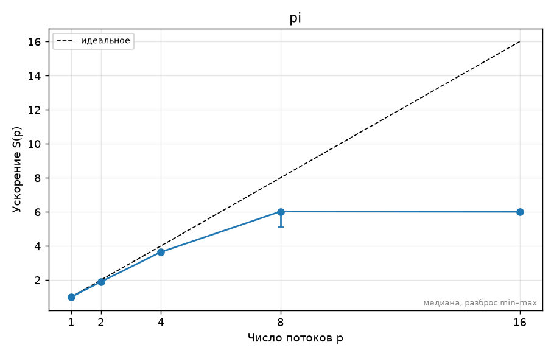

<!-- template:unfilled  ← удалите эту строку, когда отчёт готов к сдаче (иначе CI его не проверяет) -->
# ДЗ N. Название задания — Фамилия Имя, вариант V

## 1. Прогноз

На 2 потоках ожидаю ускорение примерно в 1.8–2 раза по сравнению с последовательным выполнением. На 4 потоках ожидаю ускорение примерно в 3–4 раза, так как в процессоре Apple M2 есть 4 производительных ядра.

При увеличении числа потоков до 8 будут задействованы также 4 энергоэффективных ядра. Поэтому ожидаю дальнейшее уменьшение времени выполнения, однако ускорение уже не будет близким к линейному, поскольку P- и E-ядра имеют разную производительность.

При использовании 8 потоков ожидаю ускорение меньше 8 раз. При использовании 16 потоков ускорения относительно 8 потоков, скорее всего, не будет, поскольку процессор имеет только 8 физических и 8 логических процессоров и не поддерживает SMT. Избыточное количество потоков может даже увеличить время выполнения из-за затрат на планирование и переключение потоков.

## 2. Стенд

<!-- Ссылка на ../SYSTEM.md и то, что важно именно для этого ДЗ: число физических ядер,
     P/E-ядра, объём L3, питание от сети, режим производительности, версия компилятора и флаги. -->

## 3. Методика

<!-- Какие программы и с какими параметрами запускались, сколько повторов, как получено
     итоговое число (медиана), переменные OMP_* (OMP_PROC_BIND, OMP_PLACES, OMP_SCHEDULE…),
     точные команды bench.py/plot.py (или «make bench plots»). Как проверялась корректность. -->

## 4. Результаты

<!-- Таблицы (python3 ../tools/plot.py results/….csv --table) и графики из plots/.
     Каждый график — с подписью: что на нём и какой вывод из него следует.
     Пример вставки:  -->

## 5. Объяснение расхождений с прогнозом

<!-- Для каждого пункта прогноза: подтвердился или нет, почему. Привязывайтесь к конкретным
     точкам: «на 6 потоках ускорение упало с 3,4 до 3,1, потому что …». Минимум две
     «неочевидные» точки графика объяснить обязательно. -->

## 6. Выводы

<!-- 3–5 пунктов: что вы теперь знаете о своей машине и о задаче, что бы сделали дальше. -->
