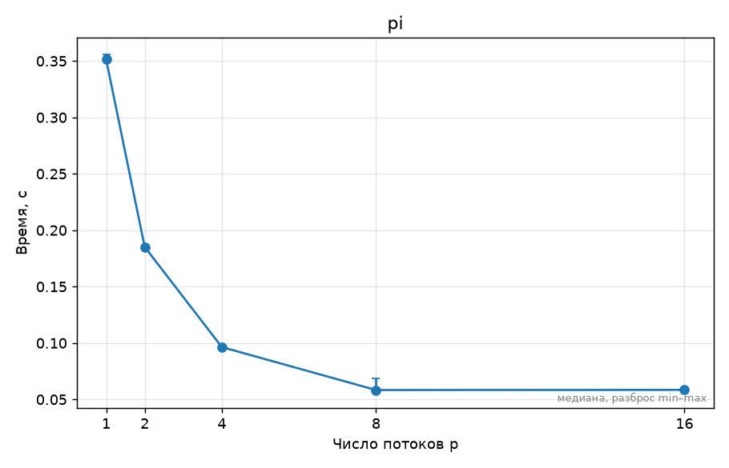
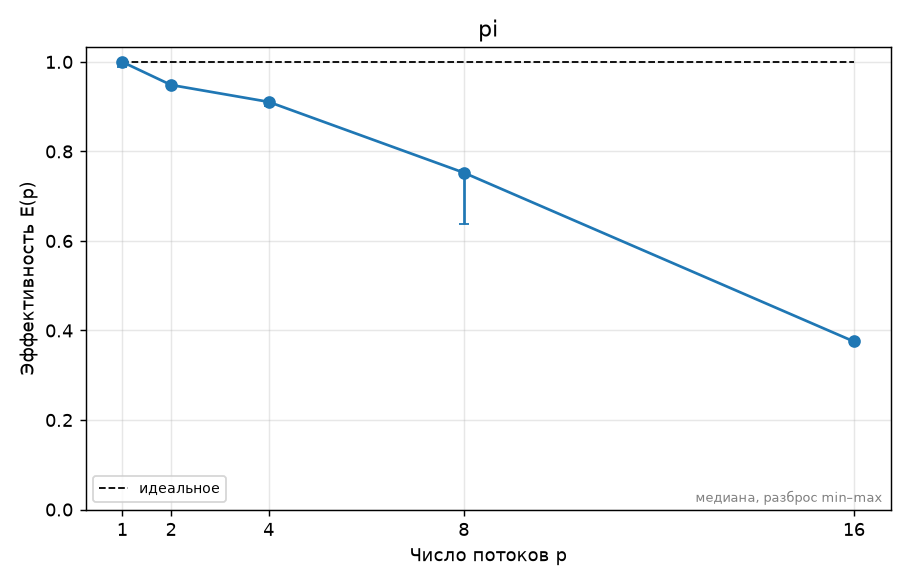

# ДЗ N. Название задания — Фамилия Имя, вариант V

## 1. Прогноз

На 2 потоках ожидаю ускорение примерно в 1.8–2 раза по сравнению с последовательным выполнением. На 4 потоках ожидаю ускорение примерно в 3–4 раза, так как в процессоре Apple M2 есть 4 производительных ядра.

При увеличении числа потоков до 8 будут задействованы также 4 энергоэффективных ядра. Поэтому ожидаю дальнейшее уменьшение времени выполнения, однако ускорение уже не будет близким к линейному, поскольку P- и E-ядра имеют разную производительность.

При использовании 8 потоков ожидаю ускорение меньше 8 раз. При использовании 16 потоков ускорения относительно 8 потоков, скорее всего, не будет, поскольку процессор имеет только 8 физических и 8 логических процессоров и не поддерживает SMT. Избыточное количество потоков может даже увеличить время выполнения из-за затрат на планирование и переключение потоков.

## 2. Стенд

Эксперименты проводились на MacBook с процессором Apple M2.

Процессор содержит 8 физических ядер: 4 производительных P-ядра и 4 энергоэффективных E-ядра. Число логических процессоров также равно 8.

Объём оперативной памяти — 8 ГБ. Использовалась macOS 27.0.1 arm64, компилятор Apple Clang 21.0.0 и OpenMP 5.1.

Подробная информация о системе приведена в файле `SYSTEM.md`.

## 3. Методика

Для измерений использовалась программа вычисления числа π с помощью OpenMP.

Размер задачи был одинаковым для всех экспериментов:

`n = 400000000`.

Измерения проводились для следующего числа потоков:

`1, 2, 4, 8, 16`.

Для каждой конфигурации выполнялось 5 запусков. Результаты записывались в `results/pi.csv`.

После проведения измерений с помощью скрипта `plot.py` были построены графики времени выполнения, ускорения и эффективности.

## 4. Результаты

Полученная таблица ускорения:

| — | threads=1 | threads=2 | threads=4 | threads=8 | threads=16 |
|---|---|---|---|---|---|
| — | 1.00 | 1.90 | 3.64 | 6.02 | 6.01 |

Среднее время выполнения по результатам пяти запусков составило примерно:

| Число потоков | Время, с |
|---:|---:|
| 1 | 0.352 |
| 2 | 0.185 |
| 4 | 0.096 |
| 8 | 0.060 |
| 16 | 0.058 |

График времени выполнения:

График ускорения:

График эффективности:

## 5. Объяснение результатов

При переходе с 1 потока на 2 ускорение составило 1.90, то есть масштабирование получилось почти линейным.

На 4 потоках ускорение составило 3.64. Это также близко к ожидаемому результату, поскольку Apple M2 имеет 4 производительных ядра.

При переходе к 8 потокам ускорение увеличилось до 6.02. Оно уже заметно меньше идеального ускорения 8, что можно объяснить использованием не только производительных, но и энергоэффективных ядер, которые имеют меньшую производительность.

При увеличении числа потоков с 8 до 16 ускорение практически не изменилось: 6.02 против 6.01. Это связано с тем, что процессор имеет всего 8 физических и 8 логических процессоров. Дополнительные потоки не получают отдельных вычислительных ресурсов и создают дополнительные накладные расходы.

Таким образом, фактические результаты в целом совпали с прогнозом.

## 6. Выводы

В ходе работы была проверена работа OpenMP на процессоре Apple M2 и исследовано влияние количества потоков на время выполнения параллельной программы.

Наилучшее ускорение было получено при использовании 8 потоков и составило примерно 6 раз относительно однопоточного выполнения.

Увеличение числа потоков до 16 практически не дало дополнительного ускорения. Это показывает, что увеличение числа потоков сверх числа доступных аппаратных ядер не обязательно приводит к росту производительности.

Также результаты показывают влияние неоднородной архитектуры Apple M2: первые 4 производительных ядра обеспечивают почти линейное масштабирование, а подключение энергоэффективных ядер даёт дополнительное, но уже менее эффективное ускорение.
