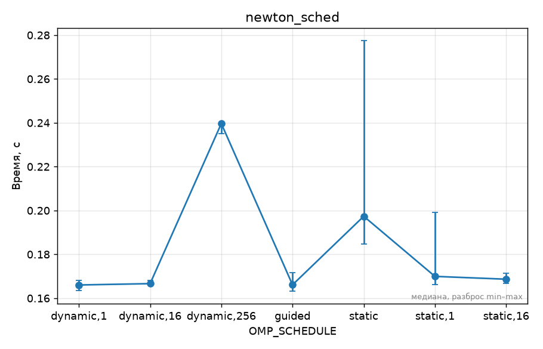
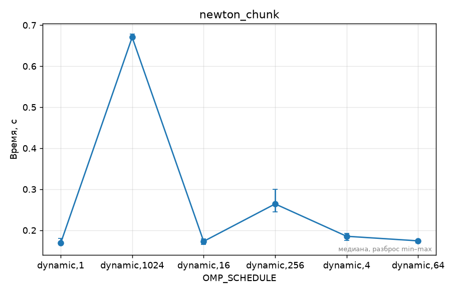
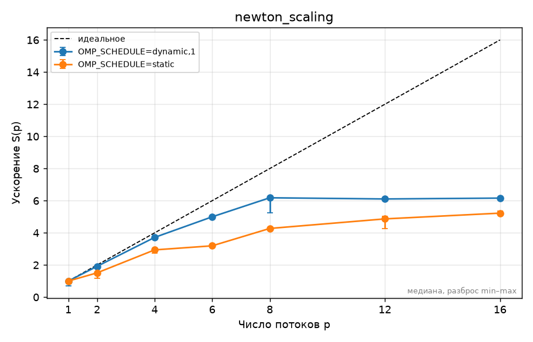
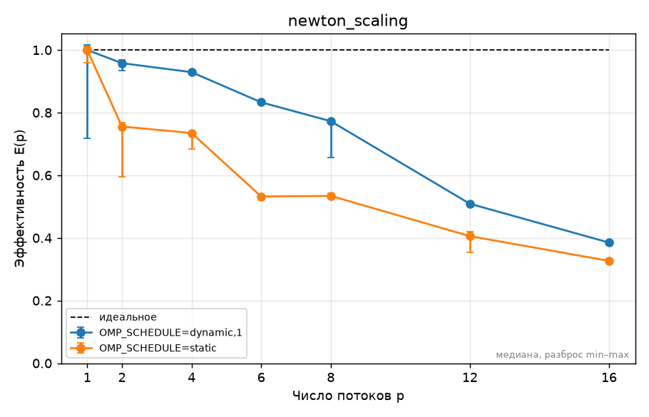
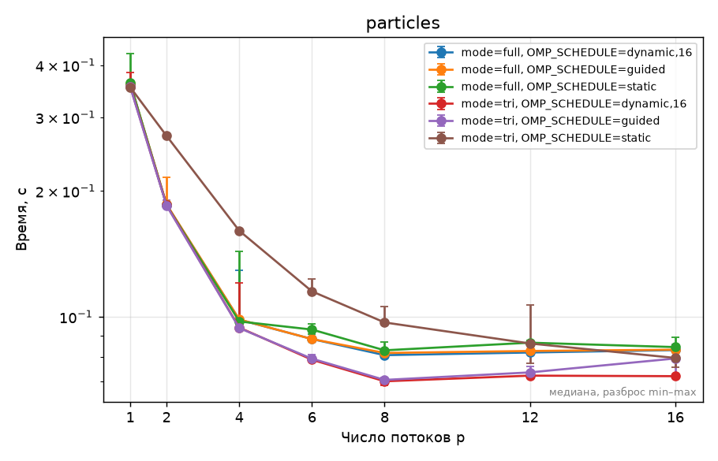
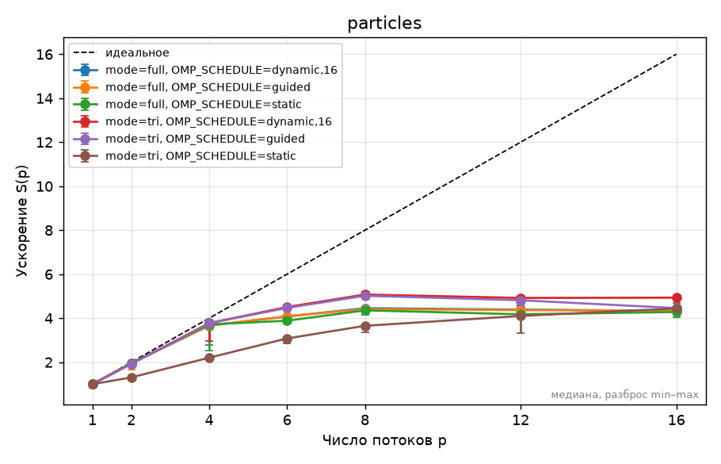

# ДЗ 1. Циклы и балансировка нагрузки — Суслов Егор, вариант 13

## 1. Прогноз

Для Ньютона распараллеливаю внешний цикл по строкам. На 16 потоках ожидаю, что `dynamic,16` обгонит `static` примерно в 1,3 раза. При `static` поток получает непрерывный блок строк, а около границ бассейнов нужно больше итераций. При `dynamic` освободившийся поток может взять следующую порцию.

Для `dynamic` ожидаю оптимум при порции в 16 строк. При одной строке потоки будут слишком часто запрашивать новую работу, а при 256 строках на сетке из 2000 строк получится всего восемь порций на 16 потоков. На 8 потоках ожидаю ускорение примерно в 5 раз относительно одного потока. В ДЗ0 получилось около шести раз, а здесь часть выигрыша может уйти на распределение строк.

На 16 потоках ожидаю, что `tri` с лучшим для неё расписанием будет примерно в 1,4 раза быстрее `full` с лучшим для неё расписанием. В `tri` каждая пара считается один раз, но часть выигрыша уйдёт на слияние приватных массивов сил. Для `full` должно хватить `static`: для каждой частицы перебирается одинаковое число соседей, поэтому объём работы по потокам будет примерно одинаковым.

## 2. Стенд

MacBook Air с Apple M2, 4 производительных и 4 энергоэффективных ядра, 8 логических процессоров, 8 ГБ ОЗУ. Замеры выполнены от сети на macOS 27.2.1 arm64. Сборка Apple Clang 21.0.0 (clang-2100.4.1.1) с `-O2 -std=c11 -Xpreprocessor -fopenmp` и Homebrew libomp. Остальные характеристики приведены в [паспорте стенда](../SYSTEM.md).

## 3. Методика

Вариант 13. Для Ньютона использовалась сетка 2000×2000 и многочлен z⁵−1. Распараллелен внешний цикл: все записи одной строки принадлежат одному потоку, а размеры порций из задания измеряются в строках. Для частиц использовались 13 824 частицы и потенциал Леннарда — Джонса без обрезания. `full` вычисляет каждую пару дважды и делит суммарную энергию пополам. `tri` вычисляет пару один раз и суммирует три приватных массива сил.

Из каталога `hw1` последовательно выполнены команды ниже. `OMP_NUM_THREADS` и `OMP_SCHEDULE` задавал скрипт. Итоговое время — медиана пяти повторов. Ускорение — отношение медианы на одном потоке к медиане на выбранном числе потоков для той же реализации и расписания.

```sh
../.venv/bin/python ../tools/bench.py --cmd './build/newton 13 {nx} {nx} par' --threads 16 --set nx=2000 --env 'OMP_SCHEDULE=static;static,1;static,16;dynamic,1;dynamic,16;dynamic,256;guided' --repeat 5 --out results/newton_sched.csv
../.venv/bin/python ../tools/bench.py --cmd './build/newton 13 {nx} {nx} par' --threads 16 --set nx=2000 --env 'OMP_SCHEDULE=dynamic,1;dynamic,4;dynamic,16;dynamic,64;dynamic,256;dynamic,1024' --repeat 5 --out results/newton_chunk.csv
../.venv/bin/python ../tools/bench.py --cmd './build/newton 13 {nx} {nx} par' --threads 1,2,4,6,8,12,16 --set nx=2000 --env 'OMP_SCHEDULE=static;dynamic,1' --repeat 5 --out results/newton_scaling.csv
../.venv/bin/python ../tools/bench.py --cmd './build/particles 13 {mode}' --threads 1,2,4,6,8,12,16 --set mode=full,tri --env 'OMP_SCHEDULE=static;dynamic,16;guided' --repeat 5 --out results/particles.csv
make plots tables PYTHON=../.venv/bin/python
```

Время каждого потока снято отдельными диагностическими запусками с `NEWTON_THREAD_TIMES=1`, до барьера окончания параллельной области. `make test` прошёл на 1, 2 и 4 потоках для пяти расписаний. У Ньютона сравнивались все точки, у частиц — энергия и силы с относительным допуском 10⁻¹⁰. Локальный `make tsan` выдал `WARNING: ThreadSanitizer: data race` при чтении результата редукции Ньютона после параллельной области. Archer в установленном libomp недоступен. В рамках OpenMP чтение выполняется после завершения редукции на границе параллельной области. Предупреждение осталось открытым, поэтому прогон TSan не засчитан.

## 4. Результаты

### Ньютон: расписания на 16 потоках
<!-- медиана времени, с -->
| — | OMP_SCHEDULE=dynamic,1 | OMP_SCHEDULE=dynamic,16 | OMP_SCHEDULE=dynamic,256 | OMP_SCHEDULE=guided | OMP_SCHEDULE=static | OMP_SCHEDULE=static,1 | OMP_SCHEDULE=static,16 |
|---|---|---|---|---|---|---|---|
| — | 0.166 | 0.1666 | 0.2397 | 0.1661 | 0.1974 | 0.17 | 0.1687 |
### Ньютон: размер порции dynamic на 16 потоках
<!-- медиана времени, с -->
| — | OMP_SCHEDULE=dynamic,1 | OMP_SCHEDULE=dynamic,1024 | OMP_SCHEDULE=dynamic,16 | OMP_SCHEDULE=dynamic,256 | OMP_SCHEDULE=dynamic,4 | OMP_SCHEDULE=dynamic,64 |
|---|---|---|---|---|---|---|
| — | 0.1686 | 0.6705 | 0.173 | 0.2642 | 0.1854 | 0.1742 |
### Ньютон: ускорение относительно одного потока
<!-- ускорение -->
| OMP_SCHEDULE | threads=1 | threads=2 | threads=4 | threads=6 | threads=8 | threads=12 | threads=16 |
|---|---|---|---|---|---|---|---|
| dynamic,1 | 1.00 | 1.92 | 3.72 | 5.00 | 6.18 | 6.11 | 6.16 |
| static | 1.00 | 1.51 | 2.94 | 3.19 | 4.27 | 4.87 | 5.23 |
### Частицы: медианное время, с
<!-- медиана времени, с -->
| mode / OMP_SCHEDULE | threads=1 | threads=2 | threads=4 | threads=6 | threads=8 | threads=12 | threads=16 |
|---|---|---|---|---|---|---|---|
| full / dynamic,16 | 0.3605 | 0.1851 | 0.0984 | 0.08843 | 0.08093 | 0.08211 | 0.08321 |
| full / guided | 0.3615 | 0.1857 | 0.09849 | 0.08841 | 0.0819 | 0.0828 | 0.08339 |
| full / static | 0.3621 | 0.1849 | 0.09744 | 0.09318 | 0.08311 | 0.08668 | 0.0846 |
| tri / dynamic,16 | 0.3557 | 0.1849 | 0.0942 | 0.07891 | 0.07007 | 0.07229 | 0.07208 |
| tri / guided | 0.3544 | 0.1844 | 0.09394 | 0.07936 | 0.0706 | 0.07359 | 0.07946 |
| tri / static | 0.3541 | 0.2708 | 0.1606 | 0.115 | 0.09689 | 0.0863 | 0.07969 |

### Время работы каждого потока в задаче Ньютона

| Поток | static, с | dynamic,1, с |
|---:|---:|---:|
| 0 | 0,1293 | 0,1667 |
| 1 | 0,1406 | 0,1567 |
| 2 | 0,1622 | 0,1668 |
| 3 | 0,2026 | 0,1669 |
| 4 | 0,2048 | 0,1667 |
| 5 | 0,1708 | 0,1495 |
| 6 | 0,1388 | 0,1496 |
| 7 | 0,1378 | 0,1558 |
| 8 | 0,1290 | 0,1670 |
| 9 | 0,1267 | 0,1494 |
| 10 | 0,1147 | 0,1495 |
| 11 | 0,1115 | 0,1565 |
| 12 | 0,1269 | 0,1665 |
| 13 | 0,1190 | 0,1568 |
| 14 | 0,1162 | 0,1669 |
| 15 | 0,1240 | 0,1664 |


На изображении видны границы бассейнов, где точкам нужно больше итераций.



На 16 потоках `dynamic,1`, `guided` и `dynamic,16` дали близкие медианы.



Порция в 1024 строки оставляет только две порции на всю сетку.



У `dynamic,1` ускорение достигает 6,18 на восьми потоках и затем выходит на плато.



После восьми потоков эффективность падает при почти неизменном ускорении.



На 16 потоках лучшие медианы `full` и `tri` составили 0,0832 и 0,0721 с.



Ускорение каждой кривой считается относительно её собственного однопоточного запуска. Для выбора между `full` и `tri` сравнивается абсолютное время.

## 5. Объяснение расхождений с прогнозом

1. На 16 потоках `static` занял 0,1974 с, `dynamic,16` — 0,1666 с. Выигрыш составил 1,18 раза при прогнозе 1,3. Наименьшая медиана у `dynamic,1` (0,1660 с), практически такая же у `guided` (0,1661 с). На картинке границы проходят через разные блоки строк. Для сетки 2000×2000 суммирование счётчиков по блокам `static` показало минимум у потока 11 (строки 1375–1499, 2110465 итераций) и максимум у потока 3 (строки 375–499, 5876927 итераций). На время также влияет разница между P- и E-ядрами.
2. `static,1` раздаёт соседние строки разным потокам по кругу. Дорогие участки распределяются равномернее, а выдача работы не требует динамической очереди. Получилось 0,1700 с против 0,1660 с у динамического варианта.
3. Мелкая порция повышает частоту выдачи работы, крупная оставляет потоки без задач ближе к концу. Первый эффект на этой сетке оказался меньше выигрыша от балансировки: минимум у порции 1 (0,1686 с), а порции 16 и 64 отстали умеренно (0,1730 и 0,1742 с). Порция 1024 дала 0,6705 с. Прогноз про 16 строк не подтвердился.
4. В `tri` длина строки равна N−i−1. При `static` на 16 потоках первый поток получает 864 строки и долю 864·(2·13824−864−1)/(13824·13823) ≈ 12,11% всех пар при идеальной доле 6,25%. Медиана всей версии на 16 потоках составила 0,0797 с с `static` и 0,0721 с с `dynamic,16`. Общий замер отражает эффект балансировки вместе с работой планировщика и редукцией. Время первого потока для частиц отдельно не измерялось.
5. На 16 потоках лучшие расписания — `dynamic,16` для `full` и `dynamic,16` для `tri`. Отношение времён `full/tri` равно 1,15 при прогнозе 1,4. Для `full` медианы `static`, `dynamic,16` и `guided` составили соответственно 0,0846, 0,0832 и 0,0834 с. Разница между лучшим расписанием и `static` составила около 1,7%, поэтому выигрыш от смены расписания в этом прогоне мал. У `full` одинаковое число пар на строку и локальные аккумуляторы. У `tri` меньше вычислений, но больше записей и есть объединение приватных копий. На 16 потоках эти копии занимают 16·3·13824·8 = 5 308 416 байт (5,06 МиБ), без учёта исходных массивов. Для объединения нужно обработать порядка 663 552 значений `double`. Его время отдельно не измерялось.
6. Синхронизация на каждом обновлении `F[j]` дорога: атомарные операции добавляют накладные расходы и конкуренцию за общие строки кэша, а `critical` пропускает только один поток за раз. Редукция переносит объединение результатов за пределы горячего цикла.
7. Энергия складывается в арифметике `double`. Смена расписания меняет порядок сложений и накопленное округление. `make test` подтвердил расхождения в пределах допуска. У Ньютона суммируются целые количества итераций, вход каждой точки одинаков и переполнения на выбранной сетке нет. Во всех замерах итог равен 54 903 651.
8. Ускорение Ньютона на 8 потоках достигло 6,18 вместо ожидаемых 5, а на 16 осталось примерно тем же (6,16). Это согласуется с восемью аппаратными ядрами: дополнительные потоки делят ресурсы. Вторая заметная точка — резкий рост времени при порции 1024, когда 2000 строк распределяются всего между двумя рабочими потоками.

## 6. Выводы

- Для Ньютона на этом стенде `dynamic,1` хорошо распределяет дорогие строки. `guided` дал близкое время на 16 потоках.
- В задаче с частицами сравнивать `full` и `tri` нужно по абсолютному времени и с учётом расписания. Редукция по массивам позволяет сохранить однократный расчёт пары.
- На Apple M2 восемь потоков дают практически тот же результат по времени Ньютона, что шестнадцать, поэтому восемь подходят как базовая конфигурация для этой задачи.
- Сравнение с версией студента варианта 4 показало, как `collapse(2)` меняет единицу порции и требования к расписанию. Подробности приведены в [аудите](review/README.md).
